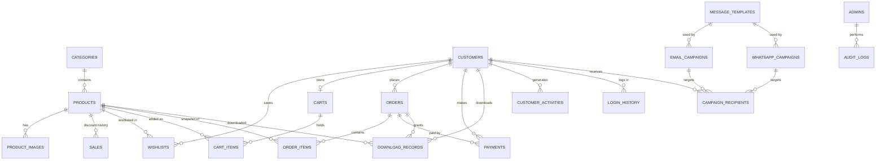

# DIGI-VERSE — Database Schema

PostgreSQL 14+ · SQLAlchemy 2.0 (typed `Mapped[]` models) · Alembic migrations.

- **Models:** `backend/app/models/`
- **Migrations:** `backend/migrations/versions/`
- **Primary keys:** every table uses a `UUID` key, generated by `gen_random_uuid()` in PostgreSQL or `uuid4()` in the app. UUIDs can't be guessed or counted the way sequential IDs can.
- **Timestamps:** stored as `TIMESTAMPTZ` and set by the database (`now()`). The `updated_at` column changes on every ORM update.
- **Enumerations:** stored as `VARCHAR(32)` plus a named `CHECK` constraint. Values are lowercase (see `app/models/enums.py`).
- **Constraint naming:** names follow one fixed pattern: `pk_<table>`, `fk_<table>_<col>_<ref>`, `uq_<table>_<cols>`, `ck_<table>_<name>`, `ix_<...>`.

---

## Entity Relationship Overview



---

## Tables

Legend: **PK** primary key · **FK** foreign key · **UQ** unique · **NN** not null.

### 1. `admins` — Administrators
| Column | Type | Notes |
|---|---|---|
| id | UUID | PK |
| username | VARCHAR(50) | NN, UQ |
| email | VARCHAR(255) | NN, unique case-insensitive (`uq_admins_email_lower` on `lower(email)`) |
| password_hash | VARCHAR(255) | NN, bcrypt hash only |
| is_active | BOOLEAN | NN, default `true` |
| last_login_at | TIMESTAMPTZ | |
| created_at / updated_at | TIMESTAMPTZ | NN |

### 2. `customers` — Customers
| Column | Type | Notes |
|---|---|---|
| id | UUID | PK |
| full_name | VARCHAR(150) | NN |
| email | VARCHAR(255) | NN, unique case-insensitive (`uq_customers_email_lower`) |
| phone_number | VARCHAR(20) | UQ, E.164 format CHECK (`+919876543210`) |
| password_hash | VARCHAR(255) | NN |
| is_email_verified / is_phone_verified | BOOLEAN | NN, default `false` |
| account_status | VARCHAR(32) | `active` · `suspended` · `deactivated` |
| email_marketing_consent | BOOLEAN | NN, default `false` (opt-in) |
| whatsapp_marketing_consent | BOOLEAN | NN, default `false`; CHECK requires `phone_number` |
| last_login_at | TIMESTAMPTZ | |
| created_at / updated_at | TIMESTAMPTZ | NN |

### 3. `categories`
| Column | Type | Notes |
|---|---|---|
| id | UUID | PK |
| name | VARCHAR(120) | NN, UQ, case-insensitive expression index `uq_categories_name_lower` |
| slug | VARCHAR(140) | NN, UQ, CHECK kebab-case |
| description | TEXT | |
| image_url | VARCHAR(1024) | |
| is_active | BOOLEAN | NN, default `true` |
| created_at / updated_at | TIMESTAMPTZ | NN |

### 4. `products`
| Column | Type | Notes |
|---|---|---|
| id | UUID | PK |
| name | VARCHAR(200) | NN |
| slug | VARCHAR(220) | NN, UQ, CHECK kebab-case |
| category_id | UUID | NN, FK → `categories.id` **ON DELETE RESTRICT** |
| image_url | VARCHAR(1024) | main image |
| short_description | VARCHAR(500) | |
| main_description / detailed_description | TEXT | |
| original_price | NUMERIC(12,2) | NN, CHECK ≥ 0 |
| product_type | VARCHAR(80) | optional digital asset type |
| metadata | JSONB | optional structured deliverable metadata |
| is_on_sale | BOOLEAN | NN, default `false` |
| is_active | BOOLEAN | NN, default `true` |
| private_download_url | VARCHAR(2048) | **Confidential** — see Security |
| created_at / updated_at | TIMESTAMPTZ | NN |

Indexes: `ix_products_active_category (is_active, category_id)`, `ix_products_created_at`, `ix_products_original_price`.

### 5. `product_images`
| Column | Type | Notes |
|---|---|---|
| id | UUID | PK |
| product_id | UUID | NN, FK → `products.id` ON DELETE CASCADE |
| image_url | VARCHAR(1024) | NN |
| display_order | INTEGER | NN, ≥ 0; UQ (`product_id`, `display_order`) |
| is_primary | BOOLEAN | NN, default `false` |

### 6. `sales` — Sales & discounts (historical)
| Column | Type | Notes |
|---|---|---|
| id | UUID | PK |
| product_id | UUID | NN, FK → `products.id` ON DELETE CASCADE |
| original_price_snapshot | NUMERIC(12,2) | NN |
| discounted_price | NUMERIC(12,2) | NN, ≥ 0 and `< original_price_snapshot` |
| starts_at / expires_at | TIMESTAMPTZ | NN, CHECK `expires_at > starts_at` |
| is_active | BOOLEAN | NN |
| created_at | TIMESTAMPTZ | NN |

Partial unique index `uq_sales_one_active_per_product (product_id) WHERE is_active`: a product can have only one active sale at a time.

### 7. `banners`
| Column | Type | Notes |
|---|---|---|
| id | UUID | PK |
| heading | VARCHAR(200) | NN |
| subtitle | VARCHAR(300) | |
| promotional_text | TEXT | |
| image_url | VARCHAR(1024) | NN |
| cta_text / cta_destination | VARCHAR | |
| display_priority | INTEGER | NN, default 0 |
| starts_at / ends_at | TIMESTAMPTZ | CHECK `ends_at > starts_at` |
| is_active | BOOLEAN | NN |
| created_at / updated_at | TIMESTAMPTZ | NN |

### 8. `advertisement_videos`
| Column | Type | Notes |
|---|---|---|
| id | UUID | PK |
| title | VARCHAR(200) | NN |
| description | TEXT | |
| video_url | VARCHAR(1024) | NN |
| thumbnail_url / destination_url | VARCHAR(1024) | |
| display_position | VARCHAR(32) | `home_hero` · `home_section` · `category_page` · `product_page` · `sidebar` |
| display_priority | INTEGER | NN |
| is_active | BOOLEAN | NN |
| created_at / updated_at | TIMESTAMPTZ | NN |

### 9. `wishlists`
| Column | Type | Notes |
|---|---|---|
| id | UUID | PK |
| customer_id | UUID | NN, FK → `customers.id` CASCADE |
| product_id | UUID | NN, FK → `products.id` CASCADE |
| created_at | TIMESTAMPTZ | NN |

UQ (`customer_id`, `product_id`) blocks duplicate wishlist entries.

### 10. `carts` / 11. `cart_items`
| Table | Column | Type | Notes |
|---|---|---|---|
| carts | id | UUID | PK |
| carts | customer_id | UUID | NN, **UQ** (one cart per customer), FK → `customers.id` CASCADE |
| carts | created_at / updated_at | TIMESTAMPTZ | NN |
| cart_items | id | UUID | PK |
| cart_items | cart_id | UUID | NN, FK → `carts.id` CASCADE |
| cart_items | product_id | UUID | NN, FK → `products.id` CASCADE |
| cart_items | quantity | INTEGER | NN, CHECK 1–100; UQ (`cart_id`, `product_id`) |
| cart_items | created_at / updated_at | TIMESTAMPTZ | NN |

### 12. `orders`
| Column | Type | Notes |
|---|---|---|
| id | UUID | PK |
| customer_id | UUID | NN, FK → `customers.id` **RESTRICT** (financial records are kept) |
| order_number | VARCHAR(40) | NN, UQ |
| total_amount | NUMERIC(12,2) | NN, ≥ 0 |
| currency | VARCHAR(3) | NN, default `INR`, ISO-4217 CHECK |
| status | VARCHAR(32) | `pending` · `confirmed` · `fulfilled` · `cancelled` · `refunded` · `failed` |
| payment_status | VARCHAR(32) | `unpaid` · `pending` · `paid` · `failed` · `refunded` |
| created_at / updated_at | TIMESTAMPTZ | NN |

Indexes: `(customer_id, created_at)`, `(status, payment_status)`.

### 13. `order_items`
| Column | Type | Notes |
|---|---|---|
| id | UUID | PK |
| order_id | UUID | NN, FK → `orders.id` CASCADE |
| product_id | UUID | FK → `products.id` **SET NULL** (the snapshot fields keep the history) |
| product_name_snapshot | VARCHAR(200) | NN |
| original_price_snapshot | NUMERIC(12,2) | NN, ≥ 0 |
| purchase_price | NUMERIC(12,2) | NN, ≥ 0 |
| quantity | INTEGER | NN, ≥ 1; UQ (`order_id`, `product_id`) |

### 14. `payments`
| Column | Type | Notes |
|---|---|---|
| id | UUID | PK |
| order_id | UUID | NN, FK → `orders.id` RESTRICT |
| customer_id | UUID | NN, FK → `customers.id` RESTRICT |
| gateway_name | VARCHAR(30) | NN, default `razorpay` |
| gateway_order_id | VARCHAR(100) | NN, **UQ** |
| gateway_payment_id | VARCHAR(100) | **UQ** (stops one gateway payment being recorded twice) |
| amount | NUMERIC(12,2) | NN, > 0 |
| currency | VARCHAR(3) | NN, ISO-4217 |
| status | VARCHAR(32) | `created` · `authorized` · `captured` · `failed` · `refunded` |
| payment_method | VARCHAR(30) | e.g. `upi` (method name only) |
| is_signature_verified | BOOLEAN | NN; CHECK: `captured` requires `true` |
| created_at / updated_at | TIMESTAMPTZ | NN |

**Duplicate-fulfilment guard:** the partial unique index `uq_payments_one_captured_per_order (order_id) WHERE status = 'captured'` allows at most one captured payment per order.

### 15. `download_records`
| Column | Type | Notes |
|---|---|---|
| id | UUID | PK |
| customer_id | UUID | NN, FK → `customers.id` RESTRICT |
| product_id | UUID | FK → `products.id` SET NULL |
| order_id | UUID | NN, FK → `orders.id` RESTRICT |
| downloaded_at | TIMESTAMPTZ | NN |
| status | VARCHAR(32) | `granted` · `completed` · `failed` · `revoked` |

### 16. `customer_activities`
| Column | Type | Notes |
|---|---|---|
| id | UUID | PK |
| customer_id | UUID | NN, FK → `customers.id` CASCADE |
| activity_type | VARCHAR(32) | `product_view`, `category_view`, `search`, `wishlist_add`, `cart_add`, `purchase`, `download`, … |
| product_id | UUID | FK → `products.id` SET NULL |
| category_id | UUID | FK → `categories.id` SET NULL |
| metadata | JSONB | structured extra data |
| created_at | TIMESTAMPTZ | NN; index (`customer_id`, `created_at`) |

### 17. `login_history`
| Column | Type | Notes |
|---|---|---|
| id | UUID | PK |
| customer_id | UUID | NN, FK → `customers.id` CASCADE |
| login_at / logout_at | TIMESTAMPTZ | CHECK `logout_at ≥ login_at` |
| ip_address | INET | optional; collect only where lawful |
| browser_info / device_info | VARCHAR(255) | |
| login_status | VARCHAR(32) | `success` · `failed` · `locked` |
| failure_reason | TEXT | |

### 18. `message_templates`
| Column | Type | Notes |
|---|---|---|
| id | UUID | PK |
| name | VARCHAR(150) | NN; UQ (`name`, `channel`) |
| channel | VARCHAR(32) | `email` · `whatsapp` |
| subject | VARCHAR(255) | required when channel = `email` |
| content | TEXT | NN |
| created_at / updated_at | TIMESTAMPTZ | NN |

### 19. `email_campaigns` / 20. `whatsapp_campaigns`
| Column | Type | Notes |
|---|---|---|
| id | UUID | PK |
| name | VARCHAR(150) | NN |
| subject | VARCHAR(255) | NN (email only) |
| content | TEXT | NN |
| template_id | UUID | FK → `message_templates.id` SET NULL |
| approved_template_name | VARCHAR(150) | NN (WhatsApp only): the template name approved by Meta |
| audience_criteria | JSONB | segment definition (filters, not customer lists) |
| status | VARCHAR(32) | `draft` · `scheduled` · `sending` · `completed` · `cancelled` · `failed` |
| created_at / completed_at | TIMESTAMPTZ | |

### 21. `campaign_recipients`
| Column | Type | Notes |
|---|---|---|
| id | UUID | PK |
| channel | VARCHAR(32) | `email` · `whatsapp` |
| email_campaign_id | UUID | FK → `email_campaigns.id` CASCADE |
| whatsapp_campaign_id | UUID | FK → `whatsapp_campaigns.id` CASCADE |
| customer_id | UUID | NN, FK → `customers.id` CASCADE |
| delivery_status | VARCHAR(32) | `queued` · `sent` · `delivered` · `read` · `failed` · `skipped` |
| provider_message_id | VARCHAR(150) | UQ |
| failure_reason | TEXT | |
| sent_at | TIMESTAMPTZ | |

Constraints:
- CHECK: exactly one campaign FK is set, and it must match `channel`.
- UQ (`email_campaign_id`, `customer_id`) and UQ (`whatsapp_campaign_id`, `customer_id`).
- **Trigger `trg_campaign_recipient_consent`:** rejects an INSERT, or an UPDATE of `channel`/`customer_id`, unless the customer is `active` and has opted in to that channel. WhatsApp also requires a phone number.

### 22. `store_settings`
| Column | Type | Notes |
|---|---|---|
| id | UUID | PK |
| key | VARCHAR(100) | NN, UQ, CHECK `^[a-z0-9_.]+$` |
| value | JSONB | NN |
| updated_at | TIMESTAMPTZ | NN |

### 23. `audit_logs`
| Column | Type | Notes |
|---|---|---|
| id | UUID | PK |
| admin_id | UUID | FK → `admins.id` SET NULL (the log outlives the admin account) |
| action | VARCHAR(100) | NN |
| entity_type | VARCHAR(100) | NN |
| entity_id | VARCHAR(100) | |
| metadata | JSONB | |
| created_at | TIMESTAMPTZ | NN |

Indexes: `(entity_type, entity_id)`, `(created_at)`.

### 24. `auth_sessions` — Refresh-Token Sessions & Reuse Detection
| Column | Type | Notes |
|---|---|---|
| id | UUID | PK (`sid` claim in JWTs) |
| subject_type | VARCHAR(32) | `customer` · `admin`; CHECK matches exactly one owner FK |
| customer_id | UUID | FK → `customers.id` ON DELETE CASCADE |
| admin_id | UUID | FK → `admins.id` ON DELETE CASCADE |
| family_id | UUID | NN, indexed (rotation chain identifier) |
| refresh_token_hash | VARCHAR(128) | NN, UQ (SHA-256 hash of active refresh token) |
| previous_token_hash | VARCHAR(128) | indexed (SHA-256 hash of rotated-out token for reuse detection) |
| ip_address | VARCHAR(64) | |
| user_agent | VARCHAR(512) | |
| expires_at | TIMESTAMPTZ | NN |
| revoked_at | TIMESTAMPTZ | |
| revoke_reason | VARCHAR(100) | |
| created_at / last_used_at | TIMESTAMPTZ | NN |

### 25. `phone_otp_challenges` — Hashed Phone Verification OTPs
| Column | Type | Notes |
|---|---|---|
| id | UUID | PK |
| customer_id | UUID | NN, FK → `customers.id` ON DELETE CASCADE |
| phone_number | VARCHAR(20) | NN, E.164 CHECK |
| purpose | VARCHAR(32) | `phone_verify` · `phone_change` |
| otp_hash | VARCHAR(128) | NN, keyed HMAC-SHA256 hash (plaintext OTP never stored) |
| attempts / max_attempts | INTEGER | NN, default `0` / `5` |
| expires_at | TIMESTAMPTZ | NN (5-minute expiry) |
| consumed_at / invalidated_at | TIMESTAMPTZ | single-use and invalidation tracking |
| created_at | TIMESTAMPTZ | NN |

### 26. `password_reset_tokens` — Single-Use Hashed Reset Tokens
| Column | Type | Notes |
|---|---|---|
| id | UUID | PK |
| customer_id | UUID | NN, FK → `customers.id` ON DELETE CASCADE |
| token_hash | VARCHAR(128) | NN, UQ (SHA-256 hash of 256-bit URL-safe token) |
| expires_at | TIMESTAMPTZ | NN |
| consumed_at / invalidated_at | TIMESTAMPTZ | single-use guard |
| requested_ip | VARCHAR(64) | |
| created_at | TIMESTAMPTZ | NN |

### 27. `payment_webhook_events` — Idempotent Gateway Webhook Ledger
| Column | Type | Notes |
|---|---|---|
| id | UUID | PK |
| gateway_name | VARCHAR(30) | NN (`razorpay` · `mock`) |
| event_id | VARCHAR(120) | NN, UQ (prevents duplicate webhook processing) |
| event_type | VARCHAR(80) | NN (`payment.captured`, `payment.failed`, `payment.refunded`) |
| gateway_order_id | VARCHAR(100) | indexed |
| gateway_payment_id | VARCHAR(100) | indexed |
| payload | JSONB | raw webhook JSON |
| processed_at | TIMESTAMPTZ | NN |

---

## Delete / Cascade Policy

| Parent deleted | Effect |
|---|---|
| Customer | Wishlists, cart (+ items), activities, login history and campaign recipients are deleted. **Blocked** if the customer has orders, payments or download records (keeps financial and audit history). |
| Category | **Blocked** while products reference it. |
| Product | Images, sales, wishlist entries and cart items are deleted. Order items and download records keep their snapshots (`product_id` → NULL). |
| Order | Order items are deleted. **Blocked** if payments or download records exist. |
| Campaign | Its recipient rows are deleted. |
| Message template | Campaign `template_id` → NULL. |
| Admin | Audit log `admin_id` → NULL. |

## Security Considerations

1. **Passwords:** only `password_hash` columns exist (bcrypt through passlib). No plaintext password column exists anywhere.
2. **Payments:** no card data, UPI PINs, UPI handles or gateway secrets are stored. Payments keep only gateway reference IDs, the amount, the status and the signature-verification result. Razorpay key secrets stay in environment variables.
3. **Store settings** are for non-secret configuration only. API keys and tokens never go into `store_settings`.
4. **Digital delivery links:** `products.private_download_url` must point to a restricted (non-public) Google Drive resource. It must never appear in public Pydantic response schemas. The download service may release it only to a customer with a paid order for that product, and logs each release in `download_records`.
5. **Admin/customer separation:** admins and customers live in separate tables with separate credentials. Elevated privilege cannot come from a customer row.
6. **Marketing consent:** consent is opt-in (default `false`) and enforced in PostgreSQL by the consent trigger and CHECK constraints, so application bugs cannot queue messages to customers who have not consented.
7. **Personal data:** email, phone, IP address and device details count as personal data. `ip_address` is optional and should be collected only on a lawful basis, with a retention policy (e.g. a periodic purge of old `login_history` rows). Deleting a customer removes their engagement data. Financial records are kept for legal and accounting reasons.
8. **Credentials:** database credentials come only from `backend/.env` (`DATABASE_URL`). Neither `alembic.ini` nor the source code contains credentials.
9. **Health endpoint:** returns only the database exception class name, never connection strings.

## Migrations Workflow

```bash
cd backend
alembic upgrade head                              # apply migrations
alembic revision --autogenerate -m "describe"     # after changing models
alembic downgrade -1                              # roll back one revision
```

`Base.metadata.create_all()` is intentionally not used anywhere. Alembic is the only way the schema changes.
