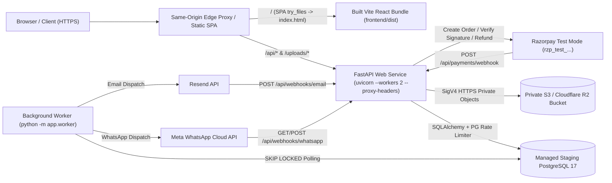

# DIGI-VERSE Staging Deployment Architecture & Hosting Guide

> [!IMPORTANT]
> **Cost & Infrastructure Approval Required Before Provisioning**
> Do **not** provision paid cloud services, custom domains, or external API keys automatically. Select a hosting option below, provision the staging resources in your cloud account, and supply the staging credentials in your platform secret manager.

---

## 1. Hosting Strategy Comparison & Recommendation

| Option | Services Required | Estimated Cost Tier | TLS & HTTPS | Worker Support | Cookie / Origin Handling | Recommendation |
| :--- | :--- | :--- | :--- | :--- | :--- | :--- |
| **Option A: Render Blueprint (`render.yaml`) + Cloudflare R2** | Render Web Service + Background Worker + Managed PostgreSQL 17 + Render Static Site + Cloudflare R2 | Starter / Low monthly managed tier (or free static site + paid PG/worker) | Automatic managed TLS | Native background worker (`python -m app.worker`) | Static site rewrite `/api/*` -> backend (`SameSite=Strict` safe) | **Recommended primary staging topology** |
| **Option B: Railway / Fly.io + Vercel** | Vercel Frontend + Railway/Fly API & Worker + Managed PG + R2/S3 | Usage-based / Hobby tier | Automatic TLS on both hosts | Dedicated worker service via `Procfile` | `frontend/vercel.json` rewrites `/api/(.*)` -> API (`SameSite=Strict` safe) | **Recommended if you prefer Vercel CDN** |
| **Option C: Docker Compose Single-Host VPS** | 1 Linux VM (`docker-compose.staging.yml`) behind Caddy/Nginx TLS | Flat monthly VPS | Managed by host reverse proxy (Caddy/Nginx + Let's Encrypt) | `worker` container (`python -m app.worker`) | Nginx proxies `/api/` and `/uploads/` on same origin | **Best for self-hosted container staging** |

---

## 2. Logical Staging Architecture



---

## 3. Process Separation (API vs Migration vs Worker)

Running `uvicorn` and background jobs in separate processes prevents duplicated campaign dispatches and avoids blocking web workers:

1. **Pre-Deploy Migration Step** (`release` in `backend/Procfile` / `preDeployCommand` in `render.yaml`):
   ```bash
   alembic upgrade head
   ```
   Runs once per deployment **before** the new API and worker processes start serving traffic.
2. **Web API Process** (`web` in `backend/Procfile` / `backend/Dockerfile`):
   ```bash
   uvicorn app.main:app --host 0.0.0.0 --port 8000 --workers 2 --proxy-headers --forwarded-allow-ips=*
   ```
   Handles synchronous customer/admin HTTP requests, `/api/ready` readiness checks, private asset streaming, and external webhooks.
3. **Background Campaign Worker** (`worker` in `backend/Procfile`):
   ```bash
   python -m app.worker
   ```
   Polls PostgreSQL with `FOR UPDATE SKIP LOCKED`, dispatches queued marketing emails/WhatsApp messages with exponential backoff, and tracks stale lock recovery.

---

## 4. Same-Origin Cookie Compatibility (`SameSite=Strict`)

DIGI-VERSE issues `ADMIN_ACCESS_COOKIE` and `ADMIN_REFRESH_COOKIE` with `SameSite=Strict` and customer auth/CSRF cookies with `SameSite=Lax`, and sets `COOKIE_SECURE=True` in staging and production (`backend/app/core/security.py`).

To ensure browser cookies are accepted and sent on every authenticated API call:

- **Approach 1 (Recommended — Same-Origin Proxy)**:
  Serve the frontend on `https://staging.your-domain.example` with `VITE_API_BASE_URL=/api`, and configure your edge proxy (`frontend/nginx.staging.conf`, `frontend/vercel.json`, or `render.yaml` rewrite rule) to proxy `/api/*` and `/uploads/*` to the FastAPI backend. The browser communicates solely with one HTTPS origin, so `SameSite=Strict` and `SameSite=Lax` cookies work without cross-origin restrictions.
- **Approach 2 (Subdomain Split)**:
  If hosting `https://app-staging.your-domain.example` and `https://api-staging.your-domain.example` on separate hosts, set `COOKIE_DOMAIN=.your-domain.example` in backend staging secrets and `VITE_API_BASE_URL=https://api-staging.your-domain.example/api` at frontend build time. Note that `SameSite=Strict` admin cookies still treat distinct domains (for example `vercel.app` -> `onrender.com`) as cross-site, so avoid cross-domain deployments without custom subdomains or same-origin proxy rewrites.

---

## 5. Persistent Cover Image Storage Note

Private digital product downloads use `S3PrivateAssetStorageProvider` (`ASSET_STORAGE_BACKEND=s3`), whereas public product cover images currently write to local disk under `UPLOAD_DIR` (`backend/app/services/storage_service.py`). When deploying the backend on container/PaaS hosts (Render, ECS, VPS), mount a persistent volume at `/app/uploads` (configured in `render.yaml` and `docker-compose.staging.yml`) so uploaded product covers persist across redeploys.

---

## 6. Deployment Steps (Render Blueprint Example)

1. Provision a **Cloudflare R2** (or AWS S3) **private** bucket (`digiverse-staging-private-assets`) with Public Access disabled.
2. Push this repository to your Git provider and connect `render.yaml` on Render.
3. Populate the secret environment variables in Render (`JWT_SECRET_KEY`, `ADMIN_JWT_SECRET_KEY`, `ASSET_STORAGE_*`, `RAZORPAY_*`, `RESEND_*`, `WHATSAPP_*`, `INITIAL_ADMIN_PASSWORD`, `CORS_ORIGINS`, `ALLOWED_HOSTS`).
4. Replace `staging.your-domain.example` and `digiverse-staging-api.onrender.com` placeholders in `render.yaml` / `frontend/vercel.json` / `frontend/nginx.staging.conf`.
5. Run the pre-flight verification script from the backend environment:
   ```bash
   python scripts/verify_staging_readiness.py --check-storage
   ```
6. Rotate `INITIAL_ADMIN_PASSWORD` immediately after verifying the initial admin sign-in.
